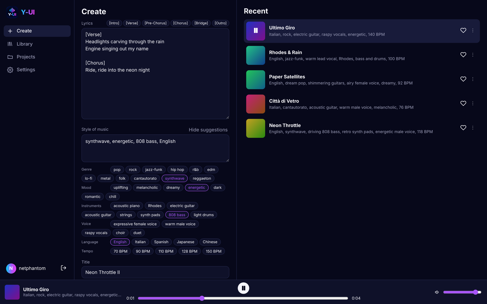
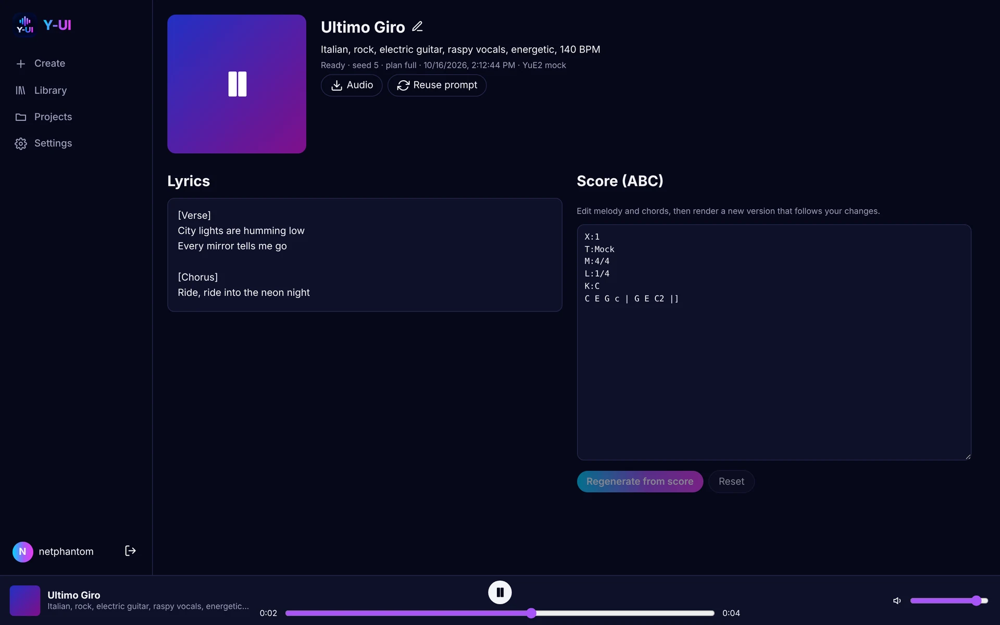
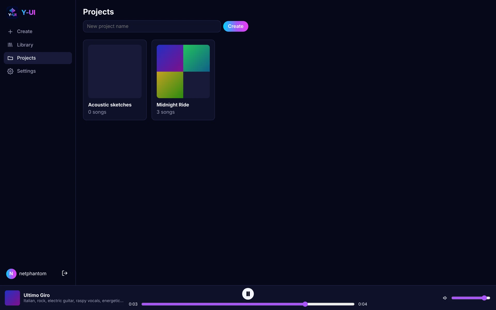
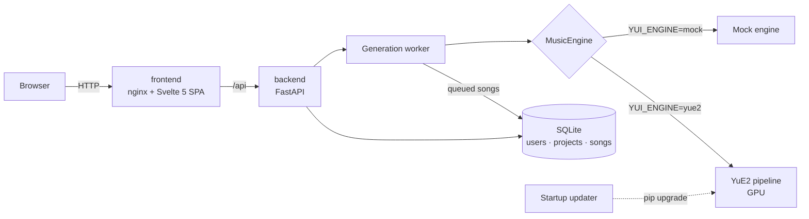

<div align="center">


# Y-UI

**A Suno-style studio for self-hosted [YuE2](https://github.com/multimodal-art-projection/YuE) music generation.**<br/>
Write lyrics, pick a style, get a full song with vocals — on your own GPU.

[](https://github.com/netphantom/Y-UITheGUI/actions/workflows/ci.yml)
[](LICENSE)
[](https://github.com/netphantom?tab=packages&repo_name=Y-UITheGUI)
[](https://huggingface.co/m-a-p/YuE2-3B)
<br/>
[](backend/pyproject.toml)
[](https://fastapi.tiangolo.com)
[](https://svelte.dev)
[](https://sqlite.org)

[Quick start](#-quick-start) · [Windows](#-windows-guide) · [Features](#-features) · [Configuration](#%EF%B8%8F-configuration) · [Architecture](#-architecture) · [Development](#-development)



</div>

## ✨ Features

- **Create like on Suno**: lyrics editor with one-click section tags (`[Verse]`, `[Chorus]`…),
  style prompt with genre / mood / instrument / voice / tempo suggestions, 1–2 variants per click.
- **Editable score**: YuE2 plans every song as an ABC melody-and-chord score. Edit it in the
  browser and render a new version that follows your changes, which Suno cannot do.
- **Library & projects**: favorites, search, status filters; group songs into albums or ideas.
- **Persistent player** with seek and volume. Download audio (FLAC) and scores (`.abc`).
- **Multi-user**: accounts with server-side sessions (real logout), first user becomes admin,
  every query scoped to its owner.
- **Always up to date**: at every start the backend checks YuE2's GitHub releases and upgrades
  itself before loading the model (can be pinned or turned off).
- **Robust queue**: one GPU, one job at a time; the queue lives in SQLite and survives restarts.
- **No GPU? No problem**: a mock engine lets you try and develop the UI anywhere.

<table>
  <tr>
    <td width="50%"></td>
    <td width="50%"></td>
  </tr>
  <tr>
    <td align="center"><sub>Song page: lyrics and editable score</sub></td>
    <td align="center"><sub>Projects</sub></td>
  </tr>
</table>

## 🚀 Quick start

**Requirements:** Docker with Compose v2. For real songs, an NVIDIA GPU with BF16 support and
~24 GB VRAM (e.g. RTX 3090 / 4090 / 5090) and ~20 GB of free disk.

### Supported platforms

| Platform | Real songs (YuE2) | UI demo (mock) | Requirements |
|---|:---:|:---:|---|
| **Linux** + NVIDIA GPU | ✅ | ✅ | Docker Engine + [NVIDIA Container Toolkit](https://docs.nvidia.com/datacenter/cloud-native/container-toolkit/latest/install-guide.html) |
| **Windows 10/11** + NVIDIA GPU | ✅ | ✅ | [Docker Desktop](https://docs.docker.com/desktop/setup/install/windows-install/) with the **WSL 2 backend** and an up-to-date NVIDIA driver. See the [Windows guide](#-windows-guide) |
| **macOS** (Intel / Apple Silicon) | ❌ | ✅ | Docker Desktop. Containers cannot use the Apple GPU and YuE2 needs CUDA, so only the mock engine runs |

### One-click install

**Linux / macOS / WSL**

```bash
curl -fsSL https://raw.githubusercontent.com/netphantom/Y-UITheGUI/main/install.sh | sh
```

**Windows** (PowerShell, with Docker Desktop running)

```powershell
irm https://raw.githubusercontent.com/netphantom/Y-UITheGUI/main/install.ps1 | iex
```

The installer sets up `~/y-ui` (change it with the `YUI_DIR` environment variable), creates
`.env` from [`.env.example`](.env.example) with your NVIDIA GPU auto-detected (mock engine if
none), pulls the images and starts everything. Open **http://localhost:8080** (Windows opens
it for you) and register: the first account is the admin.

Run the same command again to update. Your `.env` and your data are never touched.

> [!NOTE]
> The first start with YuE2 downloads the engine and the model weights (~15 GB).
> The UI works meanwhile, and songs wait in the queue until **Settings → Engine** shows *ready*.
> Follow progress with `docker compose logs -f backend`.

### Manual install

```bash
git clone https://github.com/netphantom/Y-UITheGUI.git && cd Y-UITheGUI
cp .env.example .env        # edit it: no GPU? set YUI_ENGINE=mock and COMPOSE_FILE=docker-compose.yml
docker compose up -d
```

On Windows (PowerShell) use `Copy-Item .env.example .env` and set `YUI_DATA_PATH=yui-data` in
it (see the [Windows guide](#-windows-guide)). Docker Compose reads `.env` on its own. To build the images from source instead of pulling
them, add `docker-compose.dev.yml` to `COMPOSE_FILE`.

## 🪟 Windows guide

Y-UI runs on Windows through **Docker Desktop**, which runs the Linux containers in a small
WSL 2 virtual machine. The NVIDIA driver installed on Windows exposes the GPU to that VM, so
YuE2 runs on your graphics card exactly as on Linux. You do not need to install CUDA, Python
or the NVIDIA Container Toolkit.

```
PowerShell ──► Docker Desktop ──► WSL 2 VM (Linux) ──► frontend :8080 ──► backend ──► GPU
                                                                         (via the Windows NVIDIA driver)
```

### 1. Prerequisites (once)

1. **Windows 10 22H2 or Windows 11**, with virtualization enabled in the BIOS (it usually is).
2. **NVIDIA driver**: install the latest Game Ready or Studio driver from
   [nvidia.com/drivers](https://www.nvidia.com/Download/index.aspx). It already includes
   CUDA support for WSL.
3. **WSL 2**: open PowerShell **as administrator**, run `wsl --install`, then reboot.
4. **Docker Desktop**: install it from
   [docker.com](https://docs.docker.com/desktop/setup/install/windows-install/), keep
   *Use WSL 2 instead of Hyper-V* checked, and start it. In *Settings → General* enable
   *Start Docker Desktop when you sign in* if you want Y-UI available after every reboot.
5. **Check the GPU** from a normal PowerShell. This must print your graphics card:

   ```powershell
   docker run --rm --gpus all nvidia/cuda:12.8.0-base-ubuntu24.04 nvidia-smi
   ```

### 2. Install

From a normal (non-admin) PowerShell, with Docker Desktop running:

```powershell
irm https://raw.githubusercontent.com/netphantom/Y-UITheGUI/main/install.ps1 | iex
```

The script creates `C:\Users\<you>\y-ui`, writes `.env` there with GPU mode if `nvidia-smi`
works (mock mode otherwise), pulls the images, starts Y-UI and opens
**http://localhost:8080** in your browser. Register: the first account is the admin.

The first start installs YuE2 and downloads the model (~15 GB). The UI is usable meanwhile;
**Settings → Engine** shows *ready* when generation can start.

### 3. Everyday use

All commands run in PowerShell from the install folder (`cd ~\y-ui`):

| Task | Command |
|---|---|
| Open the UI | http://localhost:8080 |
| Follow the logs | `docker compose logs -f backend` |
| Stop | `docker compose down` |
| Start again | `docker compose up -d` |
| Update Y-UI | run the install command again |
| Change settings | edit `.env` (e.g. `notepad .env`), then `docker compose up -d` |

With Docker Desktop open, the containers restart on their own after a reboot.

### 4. Where your data lives

On Windows everything (database, songs, YuE2 engine, model weights) lives in the Docker volume
**`y-ui_yui-data`**, not in a folder: SQLite on a `C:\` folder shared with the VM is slow and
its file locks are unreliable. Songs and scores can be downloaded from the UI. The volume is
visible in Docker Desktop under *Volumes*.

```powershell
# Back up to yui-data.tgz in the current folder
docker run --rm -v y-ui_yui-data:/data -v ${PWD}:/backup alpine tar czf /backup/yui-data.tgz -C /data .
# Restore (stop Y-UI first with: docker compose down)
docker run --rm -v y-ui_yui-data:/data -v ${PWD}:/backup alpine tar xzf /backup/yui-data.tgz -C /data
```

**Uninstall:** `docker compose down`, then delete the `y-ui` folder. Run `docker volume rm
y-ui_yui-data` only if you also want to delete all songs and the downloaded model.

### 5. Troubleshooting

| Symptom | Fix |
|---|---|
| `Docker is not running` | Start Docker Desktop and wait until it says *Engine running*. |
| Installer chose the mock engine on a PC with an NVIDIA card | `nvidia-smi` failed: update the driver, check step 5, then set `YUI_ENGINE=yue2` and `COMPOSE_FILE=docker-compose.yml:docker-compose.gpu.yml` in `.env` and run `docker compose up -d`. |
| **Settings → Engine** shows *failed to load* | Read the error there or in `docker compose logs backend`: most often too little VRAM, or a GPU without BF16 (pre-RTX 30 series). |
| The backend restarts while loading the model | The WSL VM ran out of RAM. Create `%UserProfile%\.wslconfig` with `[wsl2]` and `memory=24GB` on the next line, then run `wsl --shutdown` and restart Docker Desktop. |
| Disk C: is full | Docker Desktop stores its data on C: by default. Move it in *Settings → Resources → Advanced → Disk image location*. |
| Port 8080 is already in use | Set `YUI_PORT=8090` (or another free port) in `.env`, then `docker compose up -d`. |

## ⚙️ Configuration

All settings live in `.env`, kept apart from the compose files, and are applied with
`docker compose up -d`. The most useful ones:

| Variable | Default | Description |
|---|---|---|
| `COMPOSE_FILE` | `docker-compose.yml:docker-compose.gpu.yml` | Compose files to combine. Drop the GPU file on CPU-only hosts. |
| `YUI_VERSION` | `latest` | Image tag: `latest` (main) or a release such as `1.0.0`. |
| `YUI_PORT` / `YUI_BIND` | `8080` / `0.0.0.0` | Where the web UI listens. |
| `YUI_DATA_PATH` | `./data` | Database, songs, YuE2 virtualenv and model cache. |
| `YUI_ENGINE` | `yue2` | `yue2` (GPU) or `mock` (synthetic tone, for demos and development). |
| `YUI_MODEL_ID` | `m-a-p/YuE2-3B` | Hugging Face model id or local path. |
| `YUI_AUTO_UPDATE` | `true` | Upgrade YuE2 at every start when a newer release exists. |
| `YUI_YUE_PINNED_TAG` | — | Freeze YuE2 at a release, e.g. `yue2-v0.1.6`. |
| `YUI_ALLOW_REGISTRATION` | `true` | Allow new sign-ups (the first account is always allowed). |
| `YUI_COOKIE_SECURE` | `false` | Set `true` when served over HTTPS. |
| `NVIDIA_UVM_MAJOR` | `509` | Major number of `/dev/nvidia-uvm` (`ls -l /dev/nvidia-uvm`); detected by the installer. |

The full list is in [`backend/app/config.py`](backend/app/config.py) (each field maps to `YUI_<NAME>`).

### How YuE2 updates work

The backend image only contains the web stack. YuE2 and PyTorch are installed into a
virtualenv on the data volume (`data/venv-py3.12`), so they are downloaded once and survive
image upgrades. At every start, [`updater.py`](backend/app/yue/updater.py) compares the
installed `yue2-infer` with the latest GitHub release and upgrades it **before** the model is
imported. Weights are synced by `from_pretrained` through the Hugging Face cache. If the
check fails (offline, rate limit), it is logged and the installed version keeps working.

### Exposing it to the internet

1. Put a TLS reverse proxy in front, e.g. [Caddy](https://caddyserver.com):
   `yui.example.com { reverse_proxy localhost:8080 }`, and set `YUI_BIND=127.0.0.1`.
2. Set `YUI_COOKIE_SECURE=true`.
3. Once your accounts exist, set `YUI_ALLOW_REGISTRATION=false`.

## 🧱 Architecture



Two services. The **frontend** is the Svelte SPA behind nginx, which also proxies `/api`
(same origin, so the session cookie works with no CORS setup). The **backend** handles users
and projects and runs YuE2 in a single serial GPU worker.

```
backend/app/
  config.py          settings (YUI_* environment variables)
  db.py, models.py   SQLite + SQLAlchemy models
  repository.py      generic owner-scoped repository (all per-user data access)
  routers/crud.py    router factory for standard CRUD resources
  routers/           auth, songs, system
  yue/engine.py      MusicEngine protocol: YuE2 and mock implementations
  yue/worker.py      serial GPU queue backed by the songs table
  yue/updater.py     release check and upgrade at startup
frontend/src/
  lib/api.js         REST client (resource factory mirrors the backend)
  lib/*.svelte.js    shared state: auth, library (live polling), player, router
  components/, pages/
```

## 🛠 Development

```bash
# Backend (Python 3.12+)
cd backend
uv venv && uv pip install -e ".[dev]"            # use ".[dev,yue]" for the real engine
YUI_ENGINE=mock YUI_AUTO_UPDATE=false .venv/bin/uvicorn app.main:app --reload
.venv/bin/pytest

# Frontend (Node 22+): dev server on :5173, proxies /api to :8000
cd frontend
npm install && npm run dev
```

### CI/CD

[`.github/workflows/ci.yml`](.github/workflows/ci.yml) runs the backend tests and the
frontend build on every push and pull request. When they pass on `main` or on a `v*` tag, it
builds both images for `linux/amd64` and `linux/arm64` and publishes them to GitHub
Container Registry:

| Image | Tags |
|---|---|
| `ghcr.io/netphantom/y-uithegui-backend` | `latest`, `X.Y.Z`, `X.Y`, `sha-…` |
| `ghcr.io/netphantom/y-uithegui-frontend` | `latest`, `X.Y.Z`, `X.Y`, `sha-…` |

To cut a release: `git tag v1.0.0 && git push origin v1.0.0`.

## 📄 License

The code in this repository is released under the [MIT License](LICENSE).

The MIT license covers Y-UI only. [YuE2](https://github.com/multimodal-art-projection/YuE)
is a separate project that Y-UI downloads at runtime and does not redistribute: its code is
Apache-2.0 and **its model weights are CC BY-NC 4.0**, so songs generated with them may not
be used commercially.
