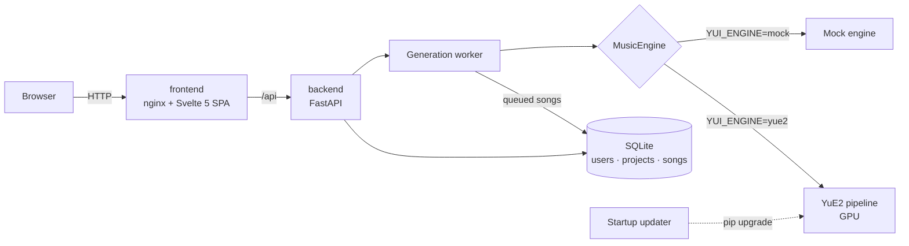

<div align="center">


# Y-UI

**A Suno-style studio for self-hosted [YuE2](https://github.com/multimodal-art-projection/YuE) music generation.**<br/>
Write lyrics, pick a style, get a full song with vocals — on your own GPU.

[](https://github.com/netphantom/Y-UITheGUI/actions/workflows/ci.yml)
[](LICENSE)
[](https://github.com/netphantom?tab=packages&repo_name=Y-UITheGUI)
[](https://huggingface.co/m-a-p/YuE2-3B)
<br/>
[](backend/pyproject.toml)
[](https://fastapi.tiangolo.com)
[](https://svelte.dev)
[](https://sqlite.org)

[Quick start](#-quick-start) · [Features](#-features) · [Configuration](#%EF%B8%8F-configuration) · [Architecture](#-architecture) · [Development](#-development)


</div>

## ✨ Features

- **Create like on Suno**: lyrics editor with one-click section tags (`[Verse]`, `[Chorus]`…),
  style prompt with genre / mood / instrument / voice / tempo suggestions, 1–2 variants per click.
- **Editable score**: YuE2 plans every song as an ABC melody-and-chord score. Edit it in the
  browser and render a new version that follows your changes, which Suno cannot do.
- **Library & projects**: favorites, search, status filters; group songs into albums or ideas.
- **Persistent player** with seek and volume. Download audio (FLAC) and scores (`.abc`).
- **Multi-user**: accounts with server-side sessions (real logout), first user becomes admin,
  every query scoped to its owner.
- **Always up to date**: at every start the backend checks YuE2's GitHub releases and upgrades
  itself before loading the model (can be pinned or turned off).
- **Robust queue**: one GPU, one job at a time; the queue lives in SQLite and survives restarts.
- **No GPU? No problem**: a mock engine lets you try and develop the UI anywhere.

<table>
  <tr>
    <td width="50%"></td>
    <td width="50%"></td>
  </tr>
  <tr>
    <td align="center"><sub>Song page: lyrics and editable score</sub></td>
    <td align="center"><sub>Projects</sub></td>
  </tr>
</table>

## 🚀 Quick start

**Requirements:** Linux with Docker and Compose v2. For real songs, an NVIDIA GPU with BF16
support and ~24 GB VRAM, plus the
[NVIDIA Container Toolkit](https://docs.nvidia.com/datacenter/cloud-native/container-toolkit/latest/install-guide.html).

### Supported platforms

| Platform | Real songs (YuE2) | UI demo (mock) | How |
|---|:---:|:---:|---|
| **Linux** + NVIDIA GPU | ✅ | ✅ | Docker Engine + [NVIDIA Container Toolkit](https://docs.nvidia.com/datacenter/cloud-native/container-toolkit/latest/install-guide.html) |
| **Windows 10/11** + NVIDIA GPU | ✅ | ✅ | [Docker Desktop](https://docs.docker.com/desktop/setup/install/windows-install/) with the WSL2 backend; run the installer **inside a WSL2 terminal** (e.g. Ubuntu), not PowerShell or Git Bash |
| **macOS** (Intel / Apple Silicon) | ❌ | ✅ | Docker Desktop. Containers cannot use the Apple GPU and YuE2 needs CUDA, so only the mock engine runs |

> [!TIP]
> On Windows keep the install folder in the WSL filesystem (the default `~/y-ui` when run
> from WSL). On a `C:\` path bind mounts are slow, and SQLite file locking over them can
> fail.

### One-click install

```bash
curl -fsSL https://raw.githubusercontent.com/netphantom/Y-UITheGUI/main/install.sh | sh
```

The installer sets up `~/y-ui` (change it with `YUI_DIR=...`), creates `.env` from
[`.env.example`](.env.example) with your GPU auto-detected (mock engine if none), pulls the
images and starts everything. Open **http://localhost:8080** and register: the first account
is the admin.

Run the same command again to update. Your `.env` and `data/` are never touched.

> [!NOTE]
> The first start with YuE2 downloads the engine and the model weights (~15 GB) into `data/`.
> The UI works meanwhile, and songs wait in the queue until **Settings → Engine** shows *ready*.
> Follow progress with `docker compose logs -f backend`.

### Manual install

```bash
git clone https://github.com/netphantom/Y-UITheGUI.git && cd Y-UITheGUI
cp .env.example .env        # edit it: no GPU? set YUI_ENGINE=mock and COMPOSE_FILE=docker-compose.yml
docker compose up -d
```

Docker Compose reads `.env` on its own. To build the images from source instead of pulling
them, add `docker-compose.dev.yml` to `COMPOSE_FILE`.

## ⚙️ Configuration

All settings live in `.env`, kept apart from the compose files, and are applied with
`docker compose up -d`. The most useful ones:

| Variable | Default | Description |
|---|---|---|
| `COMPOSE_FILE` | `docker-compose.yml:docker-compose.gpu.yml` | Compose files to combine. Drop the GPU file on CPU-only hosts. |
| `YUI_VERSION` | `latest` | Image tag: `latest` (main) or a release such as `1.0.0`. |
| `YUI_PORT` / `YUI_BIND` | `8080` / `0.0.0.0` | Where the web UI listens. |
| `YUI_DATA_PATH` | `./data` | Database, songs, YuE2 virtualenv and model cache. |
| `YUI_ENGINE` | `yue2` | `yue2` (GPU) or `mock` (synthetic tone, for demos and development). |
| `YUI_MODEL_ID` | `m-a-p/YuE2-3B` | Hugging Face model id or local path. |
| `YUI_AUTO_UPDATE` | `true` | Upgrade YuE2 at every start when a newer release exists. |
| `YUI_YUE_PINNED_TAG` | — | Freeze YuE2 at a release, e.g. `yue2-v0.1.6`. |
| `YUI_ALLOW_REGISTRATION` | `true` | Allow new sign-ups (the first account is always allowed). |
| `YUI_COOKIE_SECURE` | `false` | Set `true` when served over HTTPS. |
| `NVIDIA_UVM_MAJOR` | `509` | Major number of `/dev/nvidia-uvm` (`ls -l /dev/nvidia-uvm`); detected by the installer. |

The full list is in [`backend/app/config.py`](backend/app/config.py) (each field maps to `YUI_<NAME>`).

### How YuE2 updates work

The backend image only contains the web stack. YuE2 and PyTorch are installed into a
virtualenv on the data volume (`data/venv-py3.12`), so they are downloaded once and survive
image upgrades. At every start, [`updater.py`](backend/app/yue/updater.py) compares the
installed `yue2-infer` with the latest GitHub release and upgrades it **before** the model is
imported. Weights are synced by `from_pretrained` through the Hugging Face cache. If the
check fails (offline, rate limit), it is logged and the installed version keeps working.

### Exposing it to the internet

1. Put a TLS reverse proxy in front, e.g. [Caddy](https://caddyserver.com):
   `yui.example.com { reverse_proxy localhost:8080 }`, and set `YUI_BIND=127.0.0.1`.
2. Set `YUI_COOKIE_SECURE=true`.
3. Once your accounts exist, set `YUI_ALLOW_REGISTRATION=false`.

## 🧱 Architecture



Two services. The **frontend** is the Svelte SPA behind nginx, which also proxies `/api`
(same origin, so the session cookie works with no CORS setup). The **backend** handles users
and projects and runs YuE2 in a single serial GPU worker.

```
backend/app/
  config.py          settings (YUI_* environment variables)
  db.py, models.py   SQLite + SQLAlchemy models
  repository.py      generic owner-scoped repository (all per-user data access)
  routers/crud.py    router factory for standard CRUD resources
  routers/           auth, songs, system
  yue/engine.py      MusicEngine protocol: YuE2 and mock implementations
  yue/worker.py      serial GPU queue backed by the songs table
  yue/updater.py     release check and upgrade at startup
frontend/src/
  lib/api.js         REST client (resource factory mirrors the backend)
  lib/*.svelte.js    shared state: auth, library (live polling), player, router
  components/, pages/
```

## 🛠 Development

```bash
# Backend (Python 3.12+)
cd backend
uv venv && uv pip install -e ".[dev]"            # use ".[dev,yue]" for the real engine
YUI_ENGINE=mock YUI_AUTO_UPDATE=false .venv/bin/uvicorn app.main:app --reload
.venv/bin/pytest

# Frontend (Node 22+): dev server on :5173, proxies /api to :8000
cd frontend
npm install && npm run dev
```

### CI/CD

[`.github/workflows/ci.yml`](.github/workflows/ci.yml) runs the backend tests and the
frontend build on every push and pull request. When they pass on `main` or on a `v*` tag, it
builds both images for `linux/amd64` and `linux/arm64` and publishes them to GitHub
Container Registry:

| Image | Tags |
|---|---|
| `ghcr.io/netphantom/y-uithegui-backend` | `latest`, `X.Y.Z`, `X.Y`, `sha-…` |
| `ghcr.io/netphantom/y-uithegui-frontend` | `latest`, `X.Y.Z`, `X.Y`, `sha-…` |

To cut a release: `git tag v1.0.0 && git push origin v1.0.0`.

## 📄 License

The code in this repository is released under the [MIT License](LICENSE).

The MIT license covers Y-UI only. [YuE2](https://github.com/multimodal-art-projection/YuE)
is a separate project that Y-UI downloads at runtime and does not redistribute: its code is
Apache-2.0 and **its model weights are CC BY-NC 4.0**, so songs generated with them may not
be used commercially.
